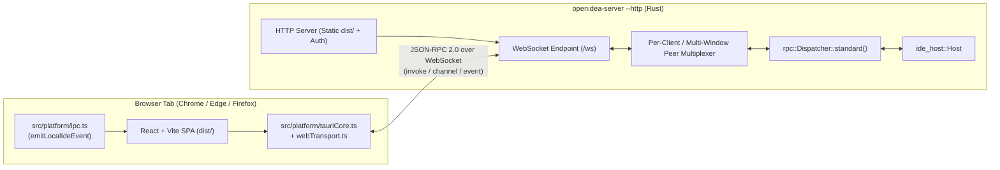

# Intent: Browser-Hosted Web IDE Mode (`openidea-server --http`)

- **Date**: 2026-10-30
- **Status**: Proposed
- **Target Component**: `crates/ide-host` (`openidea-server`), `src/platform/tauriCore.ts`, `src/platform/ipc.ts`
- **Reference Model**: Server-backed Web IDE (`code-server` / `openvscode-server` / GitHub Codespaces)

---

## 1. Objective & Context

Allow `IBLOpenIdea` to run directly inside a standard desktop web browser (Chrome, Edge, Firefox, Safari) backed by `openidea-server` over HTTP + WebSocket, without requiring the local Tauri desktop shell (`src-tauri`).

### Why Server-Backed (`code-server` model) Instead of Pure Browser/WASM (`vscode.dev` model)
Enterprise development workflows in `IBLOpenIdea` depend on OS-level processes, local/remote filesystems, and network sockets:
- **Multi-repository Git operations** (`crates/ide-vcs`)
- **Language Servers & JDK/SDK toolchains** (`jdtls`, `rust-analyzer`, `vtsls`, `pyright` via `crates/ide-lsp` and `crates/ide-sdk`)
- **Build & Run toolchains** (Maven, Gradle, Cargo, Node/pnpm, Docker via `crates/ide-build` and `crates/ide-run`)
- **Debuggers** (`crates/ide-dap`)
- **Interactive PTY Terminals** (`crates/ide-terminal`)
- **ACP Coding Agents** (`agy`, `claude`, `codex`, `opencode`, `pi` via `crates/ide-agent`)
- **Database & HTTP Clients** (`crates/ide-db`, `crates/ide-http`)

Running the UI in the browser while executing `openidea-server` on the target host (local workstation, WSL2, remote Linux VM, or Kubernetes/OpenShift dev container) preserves 100% of these capabilities with zero WASM/sandbox compromises.

---

## 2. Existing Architectural Foundation (What Already Exists)

The codebase already separates the IDE core from the Tauri desktop shell:

1. **Headless Backend Crate (`crates/ide-host`)**:
   - `ide_host::Host` holds all per-window project state, VFS, documents, LSP servers, terminals, build runners, VCS, and ACP agent sessions without any dependency on `tauri`.
2. **JSON-RPC Dispatcher (`crates/ide-host/src/rpc.rs`)**:
   - `Dispatcher::standard()` (including `ops::register_all(&mut d)`) already exposes the backend command surface over JSON-RPC 2.0:
     - `initialize` $\rightarrow$ returns `ServerInfo` (`version`, `protocol`, `os`, `arch`, `home`).
     - `commands` $\rightarrow$ lists all registered command names.
     - `invoke` (`{ window, cmd, args }`) $\rightarrow$ executes any registered command, supporting streaming channels via `{ "$channel": <id> }`.
     - Server-to-client notifications: `event` (`{ window, event: IdeEvent }`) and `channel` (`{ id, data }`).
3. **Frontend IPC Interception Point (`src/platform/tauriCore.ts` & `src/platform/remote.ts`)**:
   - `vite.config.ts` aliases `@tauri-apps/api/core` to `src/platform/tauriCore.ts`, which exposes `setInvokeRoute(route: InvokeRoute | null)`.
   - `src/platform/remote.ts` already implements `encodeArgs(args)` to serialize `Channel<T>` instances into `{ $channel: id }` descriptors.
   - `src/platform/ipc.ts` centralizes event subscriptions in `onIdeEvent(type, handler)` and `emitLocalIdeEvent(event)`.

---

## 3. Target Architecture

---

## 4. Implementation Scope (The Missing 15%)

### 4.1. Backend: HTTP + WebSocket Mode in `openidea-server`
**Files**: `crates/ide-host/src/bin/server.rs`, `crates/ide-host/src/http.rs` (new), `crates/ide-host/Cargo.toml`

1. **CLI Flags**:
   - Keep `openidea-server --stdio` unchanged for SSH remote development from the desktop app.
   - Add `openidea-server --http <host:port>` (default `127.0.0.1:8080`), `--static-dir <path>` (default `./dist` or embedded assets), `--project <path>` (optional initial project root to open), and `--token <secret>` / `OPENIDEA_WEB_TOKEN` for authentication.
2. **WebSocket JSON-RPC Bridge (`/ws`)**:
   - Accept WebSocket connections and map WebSocket text frames (raw JSON-RPC 2.0 messages, or `Content-Length` framed streams via an `AsyncRead`/`AsyncWrite` adapter) to `rpc::ServerHandler`.
   - Support multiple concurrent browser tabs (`window` labels `main`, `w2`, `w3`, ...) sharing the same `Arc<Host>` instance, routing `EventMessage { window, event }` to the matching WebSocket client(s).
   - Crucial lifecycle difference vs `--stdio`: disconnecting a single browser tab closes or detaches that `window` session (`host.close_project(&window)` only on explicit close or configurable idle timeout) rather than terminating the `openidea-server` process.
3. **Static Asset Serving**:
   - Serve the compiled Vite bundle (`dist/`) with SPA fallback (`index.html`) and cache headers for hashed `/assets/*` files.

### 4.2. Frontend: WebSocket Transport & Tauri API Shims
**Files**: `src/platform/webTransport.ts` (new), `src/platform/tauriCore.ts`, `src/platform/ipc.ts`

1. **Auto-Detection at Boot**:
   - When `!isTauri()` (`!("__TAURI_INTERNALS__" in window)`), initialize `webTransport.ts` before mounting the workbench.
   - Derive the `window` label from URL query parameter `?window=<id>` (defaulting to `"main"`).
2. **`InvokeRoute` over WebSocket**:
   - Register a global `setInvokeRoute` handler in `tauriCore.ts` when running in web mode.
   - Reuse `encodeArgs` from `src/platform/remote.ts` to replace `Channel` arguments with `{ $channel: id }`.
   - Send JSON-RPC `invoke` requests `{ window, cmd, args }` over the WebSocket:
     - On JSON-RPC result `data` $\rightarrow$ resolve `{ status: "ok", data }` (matching `tauri-specta` return shape expected by `call()`).
     - On JSON-RPC error $\rightarrow$ parse `IdeError` and resolve `{ status: "error", error }`.
3. **Server Notifications (`event` and `channel`)**:
   - When the WebSocket receives `method: "channel"`, forward `params.data` to the registered `Channel.onmessage` callback for `params.id`.
   - When the WebSocket receives `method: "event"` (where `params.window === null || params.window === currentWindow`), call `emitLocalIdeEvent(params.event)`.
4. **Pure `Channel` Polyfill Outside Tauri**:
   - In `@tauri-apps/api/core`, `new Channel()` touches `window.__TAURI_INTERNALS__.transformCallback`. Provide a lightweight browser-safe `Channel<T>` class in `src/platform/tauriCore.ts` when `!isTauri()`.

### 4.3. Desktop-Only Commands & Browser Fallbacks
A small set of commands in `src-tauri/src/commands/` use native OS windowing or dialogs (`rfd`, `tauri::WebviewWindow`, `arboard`, `open::that`). In Web mode:

| Capability | Desktop (`src-tauri`) | Browser Mode (`openidea-server --http`) |
|---|---|---|
| **Open Project / File Picker** | Native OS dialog (`rfd`) | React modal (`ServerPathPickerDialog`) browsing server directories via `commands.fsReadDir(path)` and `serverInfo.home` |
| **Window Management (`new_window`, `close_window`, maximize/minimize)** | `tauri::WebviewWindow` | `window.open("/?window=...", "_blank")`, `window.close()`, `document.title = ...` |
| **Menu Bar** | Native menu on macOS; custom React menu bar on Windows/Linux | Always use the existing custom React menu bar (`src/workbench/TitleBar.tsx`) |
| **Clipboard** | `arboard` / Tauri clipboard | `navigator.clipboard.writeText` / `readText` |
| **Open External URL** (`openUrl.ts`) | Shell open | `window.open(url, "_blank", "noopener,noreferrer")` |
| **Self-Updater (`updater.ts`)** | `tauri-plugin-updater` | Disabled in browser mode (server image/binary is managed on the host) |

### 4.4. Security & Authentication
Because `openidea-server` provides full shell (`term_spawn`), filesystem (`fs_*`), and process execution (`run_start`) privileges on the host:
1. **Bind Address**: Default to `127.0.0.1:8080` unless `--host 0.0.0.0` is explicitly passed.
2. **Token Authentication**:
   - Generate a random token on startup (or read `--token` / `OPENIDEA_WEB_TOKEN`).
   - Require `Authorization: Bearer <token>` or an `HttpOnly; SameSite=Strict` session cookie exchanged via `/auth?token=<token>` before upgrading `/ws`.
   - Validate the `Origin` header on WebSocket upgrades against the allowed host list to prevent Cross-Site WebSocket Hijacking (CSWSH).

---

## 5. Phased Delivery Plan

1. **Phase 1 — Transport & Core Boot (2 days)**:
   - Implement `Channel` browser polyfill in `src/platform/tauriCore.ts` and `src/platform/webTransport.ts`.
   - Add `--http` and `/ws` endpoint to `openidea-server` (`crates/ide-host`).
   - Audit and register any missing `Host` commands in `Dispatcher::standard()` (`crates/ide-host/src/rpc.rs`) that are currently wired only in `src-tauri/src/commands/`.
2. **Phase 2 — Browser UI Fallbacks (1–2 days)**:
   - Server-side directory/file picker modal (`Open Project…`, `Select Path…`) when `!isTauri()`.
   - Browser fallbacks for `openUrl`, clipboard, window title, and multi-tab `?window=<id>` sessions.
3. **Phase 3 — Auth, Packaging & Containerization (1–2 days)**:
   - Token cookie handshake + `Origin` check on `/ws`.
   - `Dockerfile` packaging `openidea-server`, `dist/`, Git, JDK, Node/pnpm, and ACP agent CLIs for one-command deployment on Docker / Kubernetes / OpenShift.

---

## 6. Verification & Acceptance Criteria

- [ ] Running `openidea-server --http 127.0.0.1:8080 --static-dir ./dist` and opening `http://127.0.0.1:8080` in Chrome loads the full `IBLOpenIdea` workbench without `window.__TAURI_INTERNALS__` errors.
- [ ] Opening a multi-repository project from the browser populates the Project Tree, Git Log graph, Branches panel, and file editor with LSP diagnostics and completions.
- [ ] Streaming channels (`Channel<T>`) work end-to-end in the browser for:
  - Integrated PTY Terminal (`term_spawn` / `term_write` / `term_resize`),
  - Search in Files (`search_start`),
  - Git remote progress (`vcs_remote`),
  - ACP Agent streaming sessions (`agent_prompt`).
- [ ] Opening a second browser tab (`/?window=w2`) operates on an independent project window without interfering with the first tab's `IdeEvent` stream.
- [ ] Unauthenticated requests or cross-origin WebSocket upgrades to `/ws` are rejected with `401 Unauthorized` / `403 Forbidden`.
