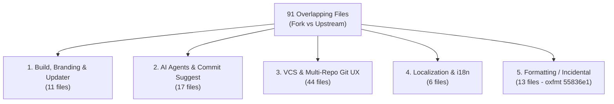

# Upstream Synchronization Audit & Strategy (`l0ng-ai/openidea` $\rightarrow$ `inno-bit-lab/ibl-openidea`)

- **Date**: 2026-10-30
- **Fork Base (Common Ancestor)**: `5b63a2b` (`v0.1.21`)
- **Current Fork HEAD (`origin/main`)**: `cd6b3a0` (`IBLOpenIdea v0.2.1`, 2 commits ahead of `5b63a2b`)
- **Current Upstream HEAD (`upstream/main`)**: `98c8c55` (`v0.1.28+`, 201 commits ahead of `5b63a2b`)

---

## 1. Executive Summary

Since `inno-bit-lab/ibl-openidea` branched from `l0ng-ai/openidea` at `5b63a2b` (`v0.1.21`), upstream has advanced through 7 point releases (`v0.1.22` $\rightarrow$ `v0.1.28+`, 201 commits), merging major improvements in Java/Maven/Gradle tooling, Angular language support, multi-project workspaces, Windows stability, debugger performance, and native Claude Code / Codex agent drivers.

At the same time, `IBLOpenIdea` (`v0.2.0` and `v0.2.1`) introduced fork-specific capabilities that **do not exist in upstream** or go significantly further than upstream's equivalents:
1. **Standalone Fork Identity & Updater** (`IBLOpenIdea`, InnoBitLab branding/icons, dedicated Minisign key `6F488B067990A3BE`, release/updater endpoints on `inno-bit-lab/ibl-openidea`).
2. **Full Italian Localization (`it`)** (`src/platform/locales/it.json`, `src/platform/locales/text/it.json` with 4,570+ translated strings).
3. **Built-in `agy` (Google Antigravity) & `pi` ACP Providers + Commit Message Suggestion AI Config** (`Agent`, `Model`, `Thinking` effort, `Rules`).
4. **Advanced IntelliJ-Parity Git UX**:
   - Multi-repo `BranchesPanel` with checked-out repo tags (`(chb, ecs, ...)`), vertical left action toolbar, and ancestor-root exclusion (`crates/ide-vcs/src/roots.rs`).
   - Direct `Update Project` execution without modal interruption and strict single-repo / subset-repo scoping for `Update`, `Push`, `Fetch`, etc.
   - Multi-repo grouped `Git Remotes` (`Manage Remotes…`) dialog and `Remote` node context menu.
   - Dedicated `History: <file>` tab in the Git tool window (`Show History`) and `History for Selection` dialog (`Show History for Selection…`) with 1-based file line offsets and rename tracking.
   - Two-pane vertical `Compare: <branchA> and <branchB>` editor tab with per-pane filter bars, commit graphs, and changed-file trees.
   - Commit tool window `View Options` (`Group By: Directory, Repository, Module` and `Show: Ignored Files`).
   - Multi-repo remote failure summary + viewport `max-height` clamping for notification balloons and dialogs.

---

## 2. High-Value Upstream Changes to Bring Into `IBLOpenIdea` (`5b63a2b..98c8c55`)

### 2.1. Java, Maven, Gradle & Debugger (Critical for Enterprise Stack)
| Commit / PR | Summary | Impact |
|---|---|---|
| `d5fe771` (#449) | Allow long `jdtls` workspace builds and make Java launch resolution cancellable | Prevents `jdtls` timeouts on large multi-module Maven/Gradle repositories |
| `0660f3c` (#493) | Resolve Java application classpaths independently of working directory | Fixes classpath resolution when launching services from sub-directories |
| `971760f` (#484) | Allow cancelling Java launch preparation | Prevents stuck launches when pre-launch build/resolution hangs |
| `2b1add6` (#446) | Refresh `jdtls` project configurations after a Maven reload | Keeps Java LSP in sync after editing `pom.xml` |
| `9575500` (#370) | Provision an isolated runtime for the Java language server | Avoids JDK conflicts between project target JDK and `jdtls` runtime |
| `4e675c1` (#210) | Start `jdtls` with a bounded heap that returns memory to the OS | Reduces idle RAM usage on multi-repo Java workspaces |
| `8ebeaa2` (#206) | Add VM options to Java run configurations | Essential for `-Xmx`, `-Dspring.profiles.active=...`, and agent flags |
| `c821ab1` (#220) | Give forked/debugged JVMs console encoding and render ANSI colors in Debug console | Fixes garbled characters and color output on Windows |
| `e017154` (#387) | Fix Java source paths on Windows and breakpoints before session start | Fixes stepping into sources and early breakpoints on Windows |
| `75e7d58` (#185) | Debug JVM scripts and Maven server goals through a JDWP agent | Enables debugging Maven goals directly |
| `92b3ae5` (#392) | Tomcat local run configuration | Adds native Tomcat server run configuration |
| `83eb1ce` (#425), `7ba75c8` (#424), `ae110f7` (#427), `f507f55` (#422), `6669df8` (#430), `2ea4787` (#297) | Maven parent POM profile inheritance, launcher resolution, sync cache freshness, unlink/re-add projects | Comprehensive Maven reliability improvements |
| `6c1eba9` (#303) | Gradle settings with Gradle JVM and distribution | Configurable Gradle JVM and wrapper/distribution |
| `e803d82` (#157) | Detect Maven / Gradle builds nested in a folder of repositories | Auto-detects Maven/Gradle in multi-repo container folders |

### 2.2. Multi-Project Workspaces, Editor & Windows Platform
| Commit / PR | Summary | Impact |
|---|---|---|
| `01defde` (#448) | Multi-project workspaces and project window groups | First-class multi-project workspace management |
| `2754cf3` (#470) | Drag an editor tab out to a standalone window | Multi-monitor editor tab detaching |
| `091c253` (#469) & `669595e` (#405) | Bind `Ctrl+Alt+Click` to Go to Implementation on Windows/Linux | Standard IntelliJ navigation shortcut on Windows |
| `5bab140` (#472) | Report incomplete rename and caller searches, make them cancellable | Cancellable LSP *Find Usages* / *Rename* |
| `ce981e4` (#414) | Resize handles for the frameless Windows window | Fixes edge resizing on Windows |
| `3563f70` (#357) & `2c10b63` (#323) | Keep the settings window on screen on Windows/Linux secondary displays | Multi-monitor window placement fix |
| `d44e241` (#299) & `181a2ea` (#300) | Decode tool output in the Windows code page & recognize Windows launcher names | Fixes Windows `.cmd`/`.bat` and non-UTF8 console output |
| `98c8c55` (#495) | Scroll Project Tree horizontally when rows are wider than the pane | Prevents clipped deep Java package paths |

### 2.3. Angular, TypeScript, Database & Services
| Commit / PR | Summary | Impact |
|---|---|---|
| `0184a9c` (#147), `922bbf4` (#284), `7a46774` (#260), `2613e61` (#458) | Angular Language Server, `@if`/`@for` control-flow highlighting & folding, directive microsyntax | Full Angular support |
| `8fabf05` (#496) | Offer auto-imports from unopened files in projects without a `tsconfig` | Better TS/JS auto-import completion |
| `3a1e47d` (#276) & `75b1704` | Microsoft SQL Server driver support + grid range editing and SQL filters | Database tool window expansion |
| `cfd2970` (#160), `d277fc1` (#443), `fd5908e` (#386), `a3cd99d` (#345), `dd8c8b8` (#452) | Services tool window run configs, multi-selection/batch actions, reordering, Compound config picker | Complete Services & Run orchestration |

### 2.4. Git / VCS Fixes in Upstream
| Commit / PR | Summary | Impact |
|---|---|---|
| `73dd9fd` (#468) | Chunk path arguments so large rollbacks fit the Windows command line | Prevents `os error 206` on Windows when rolling back/staging many files |
| `14c7821` (#476) | Stop status write-back from restoring a pre-switch index | Fixes index race condition during branch checkout |
| `ad5f827` (#483) & `ab6fca0` (#339) | Retry safe Git commands on brief `.git/index.lock` conflicts & break self-refresh loop | Crucial stability for 16-repo workspaces |
| `e85ffa2` (#321) | Remember HTTPS Git credentials in the app secret store | Native credential persistence |
| `ad09a76` (#242) & `4410da6` (#181) | IntelliJ diff algorithm, change coloring, and synchronized side-by-side scrolling | Better diff viewer fidelity |

### 2.5. Open Upstream PR Worth Watching
- **PR [#477](https://github.com/l0ng-ai/openidea/pull/477)** (`feat(github): port IntelliJ's pull request tool window, timeline and review flow`, `+23,757 / -2,076`): Still open on upstream. Wait for upstream review/stabilization before importing due to its size.

---

## 3. Overlap & Conflict Audit (91 Overlapping Files)

Comparing `5b63a2b..HEAD` (`IBLOpenIdea v0.2.1`) against `5b63a2b..upstream/main` (`98c8c55`) yields **91 overlapping files**, which fall into 5 distinct categories:



### Category 1: Branding, Build, Release & Updater (11 files) — **KEEP FORK**
- **Files**: `Cargo.toml`, `src-tauri/Cargo.toml`, `package.json`, `src-tauri/tauri.conf.json`, `src-tauri/tauri.windows.conf.json`, `.github/workflows/release.yml`, `index.html`, `README.md`, `crates/ide-tools/src/server.rs`, `src-tauri/src/lib.rs`, `src-tauri/src/windows.rs`.
- **Resolution Rule**:
  - Preserve `productName: "IBLOpenIdea"`, version `0.2.x+`, InnoBitLab icons (`src-tauri/icons/*`), Minisign public key (`6F488B067990A3BE`), and `inno-bit-lab/ibl-openidea` updater/release URLs.
  - Keep `default = ["custom-protocol"]` in `src-tauri/Cargo.toml` and our WebView2 profile fallback in `src-tauri/src/windows.rs` (combine with upstream's `f6a0152` worktree session isolation).
  - In `.github/workflows/release.yml`, merge upstream's `f911196` (`Write latest.json once after every build`) while keeping `IBLOpenIdea` release naming and our `already_published` guard.

### Category 2: AI Agents & Commit Message Suggestion (17 files) — **MERGE BOTH**
- **Files**: `crates/ide-agent/src/{lib,model,provider,tests}.rs`, `crates/ide-core/src/workflow_settings.rs`, `crates/ide-host/src/ops/agent.rs`, `src-tauri/src/commands/agent.rs`, `src/features/agents/*`, `src/features/settings/pages/vcs.tsx`, `src/platform/workflowSettings.ts`.
- **What Upstream Changed**:
  - `0cd927e` (#151) introduced native Claude Code / Codex drivers, ACP v2, and the ACP Registry, plus model search/grouping (`#352`, `#486`), image attachments (`#439`), and bypass permission defaults (`#444`).
- **What Fork Changed**:
  - Added built-in `agy` (Google Antigravity `agy_acp_server.exe` auto-discovery) and `pi` ACP providers, `AgentsCatalogEditor.tsx`, and `Commit Message Suggestion` (`agent`, `model`, `effort` settings in `workflow_settings.rs` and `vcs.tsx`).
- **Resolution Rule**:
  - Adopt upstream's new native driver architecture (`#151`) and register `agy` and `pi` as first-class providers inside the updated `crates/ide-agent/src/provider.rs`.
  - Retain our `CommitSuggestSettings` (`agent`, `model`, `effort`) in `crates/ide-core/src/workflow_settings.rs`, `src/platform/workflowSettings.ts`, `src/features/settings/pages/vcs.tsx`, and `src/features/vcs/commitSuggest.ts`.

### Category 3: VCS & Multi-Repo Git UX (44 files) — **MERGE (PREFER FORK UX + UPSTREAM ENGINE FIXES)**
- **Files**: `crates/ide-vcs/src/{lib,roots,status}.rs`, `src/features/vcs/*`.
- **What Upstream Changed**:
  - Backend Rust fixes: Windows path chunking (`#468`), index write-back race fix (`#476`), `.git/index.lock` retry (`#483`), self-refresh loop fix (`#339`), SHA-256 repo support (`#442`), blob encoding (`#301`), HTTPS credential store (`#321`).
  - Frontend VCS additions (`#144`, `#369`, `#407`, `#433`, `#445`): some overlap with remotes, history, and branch diff.
- **What Fork Changed**:
  - `crates/ide-vcs/src/roots.rs`: ancestor Git root exclusion when opening a multi-repo container folder (`D:\chb-resources\repos`).
  - `crates/ide-vcs/src/status.rs`: ignored files reporting for `Show: Ignored Files` in `CommitView`.
  - `src/features/vcs/GitLog.tsx`, `branches.ts`, `branchMenu.ts`, `branchOps.ts`, `remoteUi.tsx`, `gitMenuDialogs.tsx`: multi-repo `Paths`/`Roots` filter popup, multi-repo `BranchesPanel` with checked-out repo names in parentheses and vertical left toolbar, direct `Update Project` without modal dialog, strict single-repo `Update` scoping, multi-repo grouped `Git Remotes` dialog.
  - `src/features/vcs/FileHistory.tsx` & `CompareBranches.tsx`: IntelliJ-style `History: <file>` tab, `History for Selection` dialog with 1-based line offsets and rename tracking, and two-pane vertical `Compare: <branchA> and <branchB>` editor view.
  - `src/features/vcs/CommitView.tsx` & `changes.ts`: `Group By` (`Directory`, `Repository`, `Module`) and `Show` (`Ignored Files`).
  - `src/features/vcs/ops.ts` & `Notifications.module.css`: multi-repo failure compaction and viewport `max-height` clamping.
- **Resolution Rule**:
  - Take **all** upstream Rust engine fixes in `crates/ide-vcs/` while preserving our ancestor-root filter in `roots.rs` and ignored-entry support in `status.rs`.
  - In `src/features/vcs/`, preserve our IntelliJ-parity components (`FileHistory.tsx`, `CompareBranches.tsx`, `CommitView.tsx` group/show options, `GitLog.tsx` vertical toolbar & multi-repo `BranchesPanel`, direct `updateProject`, and `RemotesDialog`) while integrating upstream's diff viewer improvements (`#242`, `#181`, `#445`) and resizable `PushDialog` (`#407`).

### Category 4: Localization & i18n (`en.json`, `zh.json`, `it.json`, `i18n.ts`, `textCatalog.test.ts`) — **MERGE + TRANSLATE DELTA**
- **Resolution Rule**:
  - Merge upstream's new keys in `en.json` and `zh.json`, keep `"it"` in `i18n.ts` and `schema.ts`, and run `pnpm vitest run src/platform/locales/textCatalog.test.ts src/platform/i18n.test.ts` to translate all newly added upstream strings into `src/platform/locales/it.json` and `src/platform/locales/text/it.json`.

### Category 5: Repo-Wide `oxfmt` Formatting Commit (`55836e1`)
- Upstream ran `oxfmt` across the entire repository in commit `55836e1` and enforces formatting in CI.
- **Resolution Rule**: Avoid a blind `git merge upstream/main` across unformatted files. Instead, follow the structured sync procedure below.

---

## 4. Recommended Step-by-Step Sync Procedure

When executing the upstream sync (recommended on a dedicated branch `chore/sync-upstream-0.1.28` targeting release `v0.3.0`):

1. **Create the Sync Branch from `upstream/main`**:
   ```powershell
   git fetch upstream
   git checkout -b chore/sync-upstream-0.1.28 upstream/main
   ```
   *(Starting from `upstream/main` — 201 commits — and re-applying/porting our 2 fork commits `cbae657` and `cd6b3a0` by subsystem is 10x cleaner than resolving 201 commits of `oxfmt` conflicts in reverse).*

2. **Replay Fork Subsystems in 4 Clean Commits**:
   - **Commit 1 — Fork Identity, Branding, Icons & Updater**:
     Checkout/apply `src-tauri/icons/*`, `src-tauri/tauri.conf.json`, `package.json`, `Cargo.toml`, `index.html`, `crates/ide-tools/src/server.rs`, `src/features/help/{updater.ts,AboutDialog.tsx}`, `.github/workflows/release.yml`, and `docs/intents/*`.
   - **Commit 2 — `agy` & `pi` ACP Providers + Commit Message Suggestion Settings**:
     Port `agy` and `pi` providers into `crates/ide-agent/src/provider.rs` and `CommitSuggestSettings` into `workflow_settings.rs`, `vcs.tsx`, and `commitSuggest.ts`.
   - **Commit 3 — IntelliJ-Parity Git / VCS Suite & Notification Overflow Fix**:
     Port `crates/ide-vcs/src/roots.rs`, `FileHistory.tsx`, `CompareBranches.tsx`, `CommitView.tsx` (`Group By` / `Show Ignored`), `GitLog.tsx` (vertical toolbar + multi-repo `BranchesPanel` + `Paths/Roots` popup), `remoteUi.tsx` (direct `updateProject`), `branchOps.ts` (single-repo scoping), `gitMenuDialogs.tsx` (multi-repo `Git Remotes`), `ops.ts`, `Notifications.module.css`, and `Dialog.module.css` — then run `pnpm format` (`oxfmt`) so formatting matches upstream CI.
   - **Commit 4 — Italian Localization (`it`) + Delta Strings**:
     Port `src/platform/locales/it.json`, `src/platform/locales/text/it.json`, `src/platform/i18n.ts`, `src/platform/i18n.test.ts`, and translate the new strings introduced by upstream between `v0.1.21` and `v0.1.28+`.

3. **Verification Gate Before Merging to `main`**:
   - `pnpm lint` (`oxlint`) $\rightarrow$ 0 errors
   - `pnpm format:check` (`oxfmt`) $\rightarrow$ 0 formatting diffs
   - `pnpm typecheck` $\rightarrow$ 0 errors
   - `pnpm vitest run` $\rightarrow$ all suites green (including `i18n.test.ts`, `textCatalog.test.ts`, and `src/features/vcs/__tests__/*`)
   - `cargo test --workspace` $\rightarrow$ all Rust crates green (`export_bindings` regenerating `src/bindings.ts` cleanly)
   - Push tag `v0.3.0` to `origin` and let GitHub Actions (`release.yml`) build and publish Windows, macOS, Linux, and `openidea-server` bundles automatically.
